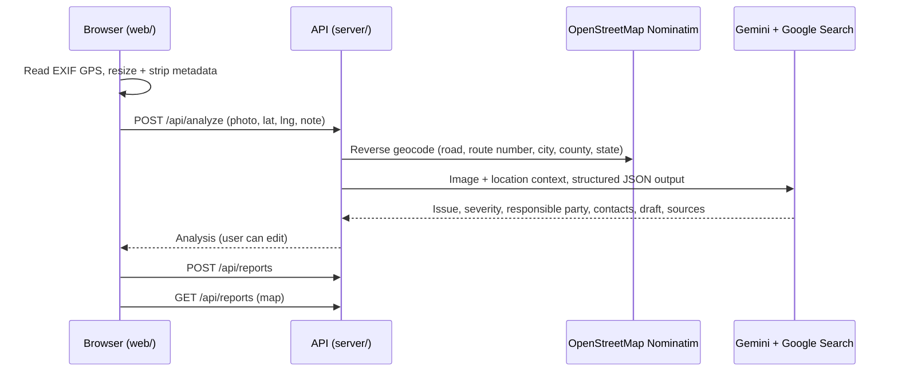

# gullhacks26-Infra

**Snap a photo of broken public infrastructure and send it to the people who actually fix it.**

Residents rarely know whether a pothole belongs to the city, the county, or the state highway administration, or that a
dead streetlight is usually the power company's job. Infra figures that out for them: upload a photo, and Gemini
identifies the problem, rates its severity, works out **which organization maintains that asset at that exact
location**, and drafts a ready-to-send report with the official contact channel.

Built for GullHacks 2026.

## Contents

- [Features](#features)
- [How it works](#how-it-works)
- [Quick start](#quick-start)
- [Configuration](#configuration)
- [Scripts](#scripts)
- [Demoing on a phone](#demoing-on-a-phone)
- [API](#api)
- [Project structure](#project-structure)
- [Troubleshooting](#troubleshooting)
- [Privacy and limitations](#privacy-and-limitations)
- [Contributing](#contributing)

## Features

- **Photo-first reporting**: take a photo with the phone camera or pick one from the library.
- **Automatic location**: reads GPS from the photo's EXIF data; falls back to device location or a draggable map pin.
- **AI issue detection**: category (pothole, streetlight, sidewalk, traffic signal, sign, water, drainage, debris,
  graffiti), severity from *low* to *hazard*, visible risks, and a confidence score. Non-infrastructure photos are rejected.
- **Responsible-party routing**: the maintaining organization, its jurisdiction level, the reasoning, alternate owners
  when ownership is ambiguous, and contact details (311 / report URL, phone, email) **taken only from cited search results**.
- **Drafted report**: an editable subject and message, with copy-to-clipboard and open-in-email.
- **Public map**: every submitted report on a map, colored by severity, with a detail page per report.
- **Privacy by default**: photos are resized and stripped of metadata in the browser before upload, and the Gemini key never reaches the browser.

## How it works



### How the responsible party is chosen

The server gives Gemini the photo plus the reverse-geocoded context. The road's **route number** (e.g. `US 13 BUS`,
`MD 12`) and **road class** are the strongest jurisdiction signals. Gemini applies ownership rules and confirms them
with Google Search:

| Asset / location                         | Usually maintained by                  |
| ---------------------------------------- | -------------------------------------- |
| Interstate, US, or state-numbered route  | State DOT / highway administration     |
| Local street inside a city or town       | That municipality's public works       |
| Local street in an unincorporated area   | County roads / public works            |
| Streetlight                              | Often the electric utility, not the city |
| Hydrant, water main                      | Water utility or authority             |
| Storm drain                              | Municipal or county stormwater         |
| Campus, park, private lot                | The property owner's facilities office |

The answer comes back as schema-validated JSON (see `analysisSchema` in [`server/src/schema.ts`](server/src/schema.ts)),
together with the search sources, which the UI shows next to the result.

### Tech stack

| Layer    | Choice                                                                 |
| -------- | ---------------------------------------------------------------------- |
| Frontend | React 19, Vite, TypeScript, Tailwind CSS 4, React Router               |
| Maps     | Leaflet + react-leaflet, OpenStreetMap tiles                           |
| Photos   | `exifr` (GPS), canvas resize/re-encode (strips metadata)               |
| Backend  | Node.js (runs TypeScript directly), Express 5, Multer, Zod             |
| AI       | Gemini via `@google/genai`: image input, Google Search grounding, structured output |
| Geocoding| OpenStreetMap Nominatim                                                |

## Quick start

**Prerequisites**
- Node.js **22.18+** (the server runs `.ts` files directly with Node's built-in type stripping)
- A Gemini API key from [Google AI Studio](https://aistudio.google.com/apikey)

```bash
git clone git@github.com:killerfrost22/gullhacks26-Infra.git
cd gullhacks26-Infra
npm install
cp server/.env.example server/.env   # open server/.env and set GEMINI_API_KEY
npm run dev
```

Open **http://localhost:5180**. The API runs on http://localhost:8787, and Vite proxies `/api` and `/uploads` to it.

> **Windows + WSL:** run npm wherever Node is installed. If Node is installed on Windows only, run the commands from
> PowerShell or Git Bash, not from a WSL shell.

Without a key the site still loads and you can pick photos and locations, but **Analyze** returns an error until
`server/.env` is set.

## Configuration

All settings live in `server/.env` (gitignored; template in [`server/.env.example`](server/.env.example)).
Restart `npm run dev` after editing it.

| Variable            | Default                               | Purpose                                                        |
| ------------------- | ------------------------------------- | -------------------------------------------------------------- |
| `GEMINI_API_KEY`    | *(required)*                          | Gemini API key. Never commit it or paste it into chats.        |
| `GEMINI_MODEL`      | `gemini-3.8-flash`                    | Must support image input **and** Google Search with structured output (Gemini 3+). |
| `PORT`              | `8787`                                | API port. If you change it, also update the proxy target in `web/vite.config.ts`. |
| `NOMINATIM_CONTACT` | *(empty)*                             | Contact email added to the Nominatim User-Agent, as its usage policy requests. |
| `NOMINATIM_URL`     | `https://nominatim.openstreetmap.org` | Point at a self-hosted Nominatim if you need more than ~1 request/second. |

## Scripts

Run from the repo root:

| Command             | What it does                                                        |
| ------------------- | ------------------------------------------------------------------- |
| `npm run dev`       | API (auto-restarts on `server/src` changes) + Vite dev server, together |
| `npm run build`     | Type-checks and builds the web app into `web/dist/`                 |
| `npm start`         | Serves the API **and** the built web app on one port (8787)         |
| `npm run typecheck` | Type-checks server and web                                          |

## Demoing on a phone

1. **Same Wi-Fi, quickest:** open `http://<your-computer-ip>:5180` on the phone (Vite prints the address on startup).
   Camera capture, photo GPS, and map pins work. Allow port 5180 through the firewall if the page doesn't load.
2. **Full features, including "Use my location":** browsers only allow geolocation over HTTPS, so use a tunnel:
   ```bash
   npm run build
   npm start
   cloudflared tunnel --url http://localhost:8787   # or: ngrok http 8787
   ```
   Then open the printed `https://…` URL on the phone.

**Tip:** photos taken through the in-browser camera often carry no GPS. For a reliable demo, take the photo with the
phone's normal camera app (location enabled), then pick it with **Choose from library**.

**Suggested demo script**
1. Phone: choose a pothole/streetlight photo, location fills in automatically.
2. Tap **Analyze with Gemini**, then walk the judges through the category, severity, responsible party, and sources.
3. Edit the draft if needed, **Submit report**, then show it on the **Map** page on the projector.

## API

| Method | Path               | Body / response                                                                     |
| ------ | ------------------ | ----------------------------------------------------------------------------------- |
| GET    | `/api/health`      | `{ ok, geminiConfigured, model }`                                                   |
| POST   | `/api/analyze`     | multipart `photo` (JPEG/PNG/WebP ≤ 10 MB), `lat`, `lng`, `note` → `AnalyzeResponse` |
| POST   | `/api/reports`     | `{ analysisId, locationSource, note, edits }` → `201 Report`                        |
| GET    | `/api/reports`     | `Report[]`, newest first                                                            |
| GET    | `/api/reports/:id` | `Report`                                                                            |

All types live in [`server/src/schema.ts`](server/src/schema.ts); the web app imports them directly, so the client and
server can't drift apart. Errors are always `{ "error": "message" }` with a meaningful status:

| Status | Meaning                                                                  |
| ------ | ------------------------------------------------------------------------ |
| 400    | Invalid input (bad coordinates, missing photo, non-infrastructure photo) |
| 404    | Unknown report, or the analysis expired (server restarted)               |
| 413    | Photo larger than 10 MB                                                  |
| 415    | Unsupported image type                                                   |
| 422    | No address found at those coordinates                                    |
| 502    | Gemini or Nominatim failed or returned something unusable                |
| 503    | `GEMINI_API_KEY` not configured                                          |

Example:

```bash
curl -F photo=@pothole.jpg -F lat=38.3655 -F lng=-75.5935 http://localhost:8787/api/analyze
```

## Project structure

```
server/src/
  index.ts       Express routes, upload handling, error mapping, serves web/dist in production
  gemini.ts      Prompt + Gemini call (image, Google Search grounding, JSON schema)
  geocode.ts     Nominatim reverse geocoding (rate-limited to 1 req/s, cached)
  schema.ts      Zod schemas + shared API types
  constants.ts   Category / severity / jurisdiction enums (dependency-free, shared with web)
  config.ts      Environment config + HttpError
  store.ts       JSON-file report store (server/data/, gitignored)
web/src/
  pages/         ReportPage (upload → analyze → submit), MapPage, ReportDetailPage, NotFoundPage
  components/    LocationPicker, ResponsibleParty, Badges, Layout
  lib/           api client, photo prep (EXIF GPS, resize), labels, Leaflet setup
```

## Troubleshooting

| Symptom                                               | Fix                                                                                   |
| ----------------------------------------------------- | ------------------------------------------------------------------------------------- |
| Yellow banner: "GEMINI_API_KEY is not set"            | Create `server/.env` with your key, then restart `npm run dev`.                       |
| "Gemini request failed: … API key not valid"          | Check the key in `server/.env` (no quotes or spaces).                                 |
| "Gemini request failed" mentioning the model          | Set `GEMINI_MODEL` to a Gemini 3+ model your key can access.                          |
| `Port 5180 is already in use`                         | Stop the other dev server, or change `server.port` in `web/vite.config.ts`.           |
| "Use my location" fails on a phone                    | Needs HTTPS; use the tunnel setup above, or tap the map instead.                      |
| "Your browser can't read this image format"           | HEIC photos only decode in Safari; export as JPEG or use an iPhone with Safari.       |
| "Analysis not found or expired"                       | The server restarted between Analyze and Submit; analyze again.                       |
| "Reverse geocoding failed"                            | Nominatim is rate-limiting or unreachable; wait a few seconds and retry.              |
| `npm` errors in WSL (`node: not found`)               | Node is only installed on Windows; run npm from PowerShell/Git Bash or install Node in WSL. |

## Privacy and limitations

- Photos are re-encoded in the browser, which strips EXIF (device model, timestamps, GPS). Location is sent only as the explicit `lat`/`lng` fields.
- Reporter notes are stored with the report; there are no accounts and no contact fields.
- Storage is a JSON file (`server/data/reports.json`) plus `server/data/uploads/`. Fine for a demo, not for production.
- Pending analyses are kept in memory; a server restart means re-analyzing before submitting.
- Responsible-party details come from Gemini's Google Search results. The UI shows the sources; **verify them before sending a real report**.
- The public Nominatim server allows about 1 request/second; the API throttles and caches lookups accordingly.

## Contributing

- Branch from `main` as `feat/<area>`, keep PRs small, and get one teammate's review before merging.
- Run `npm run typecheck` before pushing.
- Never commit `server/.env` or anything under `server/data/` (both are gitignored).
- The roadmap and task breakdown live in [TODO.md](TODO.md).
