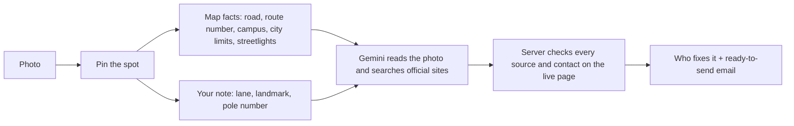
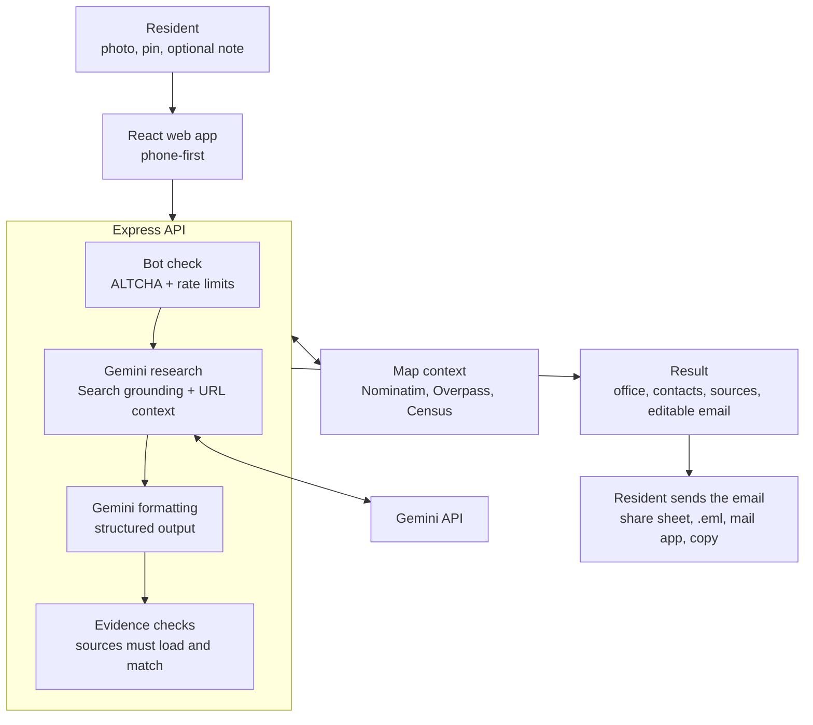

# Fix Please · fixplease.work

Spot a pothole, a dead streetlight, or something broken on campus? Take a photo, drop a pin, and Fix Please works out who is responsible for that exact spot and writes the email for you, photo attached.

Built for phones first. Works on desktop too.

Our GullHacks 2026 project. This repo (`gullhacks26-Infra`) is where the team keeps building it.

## Contents
- [Team](#team)
- [Abstract](#abstract)
- [Introduction](#introduction)
- [Demo](#demo)
- [Features](#features)
- [How it works](#how-it-works)
- [Run it locally](#run-it-locally)
- [Try it on your phone](#try-it-on-your-phone)
- [Project layout](#project-layout)
- [Checks](#checks)
- [Working on it as a team](#working-on-it-as-a-team)
- [Troubleshooting](#troubleshooting)
- [Deploy](#deploy)
- [Privacy](#privacy)
- [API](#api)
- [Credits](#credits)

## Team
| Name | Role | GitHub |
|---|---|---|
| Nyles Burton | Documentation | [@NBurtonII](https://github.com/NBurtonII) |
| Gabby Ao | Business Analyst | [@gabbyao](https://github.com/gabbyao) |
| Yizhan Ao | Programmer | [@killerfrost22](https://github.com/killerfrost22) |
| TBD | | |

## Abstract
Fix Please is an AI-powered tool that lets users photograph public infrastructure issues, pin the location, and add a short description. In return, they receive an explanation of who is responsible, how to contact them, and a ready-to-send email with the photo attached so they can make their voices heard.
 
## Introduction
Public infrastructure is a huge cause of frustration and distrust between the members of a community and its governing bodies. Residents live with these problems daily and watch them go unresolved for months. Some of these issues are small, some are large, but all build upon one another and cause people to feel as though the local government does not care about their needs or the community. To this end we created Fix Please, a phone-first web app that helps residents figure out who is responsible for a problem and gives them the words to say something about it.
 
For the GullHack Hackathon, we will focus on obvious physical environment issues. We want residents to be able to report excessive litter, potholes, broken light fixtures, etc. This system could be easily expanded, but we want to ensure that we are being realistic in what we can accomplish in our time.
 
Fix Please does not store reports or send anything on the user's behalf. There are no accounts and no database: the user reviews the drafted email and sends it from their own account. Embedding the tool in local government websites is a goal for future work (see [Future Work](#future-work)).
 
## Demo
- Live site: https://fixplease.work
- Demo Jurisdiction: Salisbury University campus and Princess Anne / University of Maryland Eastern Shore (TBC)
## Features
1. Users provide the information for a report:
    - One photo (take one on a phone or upload from the library), or none: "Report without a photo" lets someone who saw it while driving report it later, and then the description is required
    - Location, set by photo GPS, "I'm standing here" device location, address search, tapping or dragging a pin on the map, or manual coordinates. The user must confirm the pin before continuing.
    - An optional text description or clue (for example an HOA, property manager, pole number, or landmark)
2. AI and API connections use that information to work out who is responsible:
    - Gemini parses the image to determine the kind of fault and gain additional clues to location.
    - Photo metadata and the pin give an estimate of where the issue is. Map facts for the pin (road and route number, campus, mapped streetlights and operator, municipality or county) come from OpenStreetMap, Overpass, and the Census.
    - The description gives additional context about what and where the issue is.
    - Gemini uses Google Search grounding and URL context to find the responsible body and its published contact information.
3. The app returns a result that names the responsible office, explains why, and shows how confident it is ("Confirmed on an official site", "Best match. Worth a quick check.", or "We couldn't identify the office", which shows only the map facts). Contacts link to their sources, and "Before you send" warnings flag anything the user should know.
4. The app drafts an editable email (To, Subject, Message) with the photo attached. The user can send it with the phone's share sheet, download it as an `.eml` file, open it in their mail app, or copy it.
5. The system is resistant to bot attacks, so that as many requests as possible come from real people: a self-hosted ALTCHA proof-of-work check, rate limits, and a same-origin check.
6. The system is built for privacy. There are no accounts and no database, nothing is stored, and the user sends the email themselves. The Privacy page (`/privacy`) explains what is sent to Gemini.

## How it works



1. **Snap, or skip it.** The photo is shrunk on the device and its hidden metadata is stripped. If it has GPS, we use it to suggest the spot. Saw it while driving? Choose "Report without a photo" once you've parked; then the note in step 3 is required, because it's the only description of the problem.
2. **Pin.** Photo location, "I'm standing here", address search, or tap the map. You confirm the pin.
3. **Tell us more.** One free-text box: where exactly it is and what you noticed. This is often what separates "the city" from "the state highway department" or "the power company".
4. **Find who fixes it.** The server pulls map facts for the pin: the nearest road and its route number, whether you're inside a city, town, or township (U.S. Census), the campus you're on and its website, and mapped streetlights and who runs them (OpenStreetMap via Overpass, with Nominatim as the fallback when Overpass is overloaded). Gemini then reads the photo and searches official city, county, state, campus, and utility sites. With the default model (`gemini-3.6-flash`), a full test report took 22 seconds from tap to result; the server gives up after 45.
5. **Send.** On phones, "Send with photo" opens the share sheet with the photo attached. On desktop, download the email with the photo already attached, or open your mail app. We never send anything for you.

### Why you can trust the result

- A link only counts if the server can open it. Pages Google's search returned count (their redirect links are resolved to the real page first). The model can also name an office's page that search didn't return, but it counts only if it's on a government or university domain, on a site search already returned, or on the campus's own website, and it loads right now. A made-up link never loads, so it's dropped.
- "Confirmed on an official site" means the sentence that proves who covers this road or asset was found word for word on an official page we loaded. "Best match. Worth a quick check." needs at least one official page we loaded. With neither, the result says we couldn't identify the office and shows only the map facts. We never make up an office name.
- An email address or phone number only shows up if it's published on an official page we read, and an email must be a repair or service inbox on the office's own domain (e.g. `streetmaintenance@city.gov`). Personal, press, HR, and webmaster addresses are never picked. Contact details and links the model writes into its own text are removed unless they're the checked ones. Many cities only take reports through a web form, so the result often links to that form and leaves the email's To line for you.
- If Gemini refuses an answer for repeating web text too closely, the server retries once without quotes. That result can be at most "best match".

### Architecture Diagram

 
### Input
 - Photo
 - Text description (optional)
 - Location (photo GPS, device location, address search, or pin)
### Processing
- Photo is resized and re-encoded on the device, which strips its EXIF data
- Location confirmation and map context for the pin
- Bot check and rate limits
- Image analysis and issue classification
- Responsible agency search
- Contact lookup
- Evidence checks (cited pages must load, and contact details must appear on an official page)
### Output
- Issue Summary
- Responsible Agency and confidence level
- Contact Info with source links
- Warnings and a "How we know" source list
- Editable Email with the photo attached
## Run it locally

You need:

- [Node.js 24](https://nodejs.org) (check with `node --version`) and Git.
- A Gemini API key from [Google AI Studio](https://aistudio.google.com/apikey). Search grounding needs a billed Google AI project. Without a key the site still runs; see step 5.

1. **Get the code and install packages.**

   ```powershell
   git clone https://github.com/killerfrost22/gullhacks26-Infra.git   # or git@github.com:killerfrost22/gullhacks26-Infra.git if you use SSH
   cd gullhacks26-Infra
   npm install
   ```

2. **Add your key.**

   ```powershell
   Copy-Item .env.example .env   # macOS/Linux: cp .env.example .env
   ```

   Open `.env` and paste the key after `GEMINI_API_KEY=`. Leave the other lines as they are.

3. **Start it.**

   ```powershell
   npm run dev
   ```

   This starts the API and the web app together. It's ready when the terminal shows `[api] fixplease.work ready at http://127.0.0.1:8787`.

4. **Open <http://127.0.0.1:5180>.** The dev server uses port 5180, not Vite's usual 5173, so it doesn't collide with other projects. Code changes reload on their own.

5. **Check the key.** <http://127.0.0.1:5180/api/health> should show `"researchConfigured":true`. If it shows `false`, photo, map, and address search still work, but generating a report shows "Report lookup is offline right now." until the key is set.

6. **Stop it** with `Ctrl+C`. Restart `npm run dev` after any `.env` change.

The API runs on `PORT` from `.env` (default 8787) and Vite proxies `/api` to whatever port that is. If something else already uses it, the server says so and doesn't start; change `PORT` in `.env` and restart.

> **Windows + WSL:** run npm where Node is installed. If Node is only installed on Windows, use PowerShell or Git Bash, not a WSL shell. Git over SSH from WSL works fine either way.

## Try it on your phone

Location access and the bot check need HTTPS, so use a production build behind a tunnel:

```powershell
npm run build
npm start                                      # app + API on PORT
npx cloudflared tunnel --url http://127.0.0.1:8787   # use your PORT if you changed it
```

Open the `https://….trycloudflare.com` address it prints. In Safari or Chrome, "Add to Home Screen" installs it like an app. Stop the tunnel when you're done; anyone with the link can use your Gemini key while it runs.

Demoing on shared venue Wi-Fi? Everyone shows up as one address, so raise `RESEARCH_RATE_LIMIT` in `.env` (default 5 reports per 15 minutes).

## Project layout

```
server/                    Express API (run with tsx)
  index.ts                 Entry: loads .env, wires the real services, listens on HOST:PORT
  app.ts                   Routes, rate limits, same-origin check, captcha check, serves dist/ in production
  config.ts                Reads PORT, HOST, TRUST_PROXY, RESEARCH_RATE_LIMIT
  captcha.ts               Self-hosted ALTCHA proof-of-work challenges, single-use
  validation.ts, errors.ts Request parsing and the { error, code } error type
  geo/                     Map facts and address lookup
    nominatim.ts           Search and reverse lookup, one request per second, cached
    overpass.ts            Nearest road and route number, campus, street lamps; 60 s backoff after a failure
    census.ts              U.S. Census: incorporated city or unincorporated county
    context.ts             Runs all three in parallel (9 s cap), Nominatim as the fallback
  research/                Who fixes it
    pipeline.ts            Map facts → Gemini research → structured report → page checks → result
    gemini.ts              Gemini Interactions API calls; provider errors mapped to safe messages
    prompt.ts, schema.ts   Research and format prompts; Zod schema for the report
    fetch-page.ts          Loads cited pages safely (public addresses only, size and time limits)
    verify.ts              Checks quotes, emails, and phones on the loaded pages
    provenance.ts          Which domains are official and which inboxes count
  **/*.test.ts             Server tests
src/                       React app
  main.tsx, App.tsx        Entry, fonts, and routes: / (report), /tech, /privacy
  router.tsx               Tiny History API router
  flow/                    The report: PhotoStep, PinStep, PinMap (Leaflet, loaded on demand), NoteStep,
                           Investigating, ResultView, EmailComposer, ContextChips, SearchSuggestions; state.ts
  pages/                   TechPage (/tech), PrivacyPage (/privacy)
  components/              Mark (wordmark with FIX circled, map-pin ring, headline paint ring), SiteChrome (header and footer)
  lib/                     API client, captcha worker, photo prep, email and .eml builder, place labels (+ tests)
  styles/                  tokens.css (colors, type, spacing), then base, layout, flow, result, pages
  dev/                     Scene harness for design review: ?scene=<name> in dev only, absent from builds
shared/types.ts            Types shared by the server and the app
public/                    Favicon, app icons, web app manifest, share image
docs/                      Model benchmark write-up and other docs
benchmarks/gemini-models/  Model benchmark script, test photos, and raw results
submission/                Devpost write-up and video script
TODO.md                    Feature roadmap
```

## Checks

Run these before pushing:

```powershell
npm test          # server and client unit tests (node:test via tsx)
npx tsc --noEmit  # type check
npm run build     # type check + production build into dist/
```

For design changes, also follow the review loop in [`AGENTS.md`](AGENTS.md). In `npm run dev`, add `?scene=<name>` to the URL to open any state without live calls, e.g. <http://127.0.0.1:5180/?scene=result-best-match>. The scene list is in `src/dev/scenes.ts`. Scenes exist only in dev builds.

## Working on it as a team

- Branch from `main` as `feat/<what>`, keep PRs small, and get one teammate to review before merging.
- Never commit `.env`; it holds the Gemini key. `.env`, `node_modules/`, and `dist/` are already gitignored. Don't paste keys into chats or issues.
- Add a setting to `.env.example` (with a comment) whenever you add a new environment variable.
- [`TODO.md`](TODO.md) is the feature roadmap, with open items by priority. Tick them off as you go.
- [`submission/submission.md`](submission/submission.md) is the Devpost write-up and [`submission/video-script.md`](submission/video-script.md) the demo video script. Update them when features change.

## Troubleshooting

| Symptom | Fix |
|---|---|
| A different site opens, or "Port 5180 is already in use" | Another program holds port 5180. Stop it, or change `port` in `vite.config.ts`. Fix Please stays off 5173 because other projects use it. |
| "Port … is already used by another program" | Set `PORT` in `.env` to a free port and restart `npm run dev`. |
| "Report lookup is offline right now." | `GEMINI_API_KEY` is missing or invalid. Set it in `.env` and restart. |
| "We've hit our lookup limit for now." | The key's project is out of Gemini or Search grounding quota. Check billing and limits in [AI Studio](https://aistudio.google.com/usage). |
| "That's a lot of reports in a short time." | Raise `RESEARCH_RATE_LIMIT` in `.env` and restart, or wait 15 minutes. |
| "I'm standing here" or the bot check fails on a phone | They need HTTPS. Use the tunnel setup above. |
| "We couldn’t open that HEIC photo." | The HEIC file is damaged or uses a variant the decoder can't read. Export it as JPEG, or set the iPhone camera to Formats → "Most Compatible". |
| A HEIC photo takes a few seconds on Chrome or Firefox | Expected the first time: those browsers can't read HEIC, so the page downloads the decoder (about 0.8 MB) and converts the photo on the device. Safari reads HEIC itself. |
| Map facts show the city but no road, campus, or streetlights | The public Overpass server is overloaded or down; the server skips it for 60 s after a failure. Point `OVERPASS_URL` in `.env` at another instance and restart. |
| `npm` fails in WSL with `node: not found` | Node is only installed on Windows. Run npm from PowerShell or Git Bash. |

## Deploy

Any host that runs one long-lived Node process works (Render, Railway, Fly.io, a small VM):

- Build: `npm ci && npm run build`
- Start: `npm start`
- Run a single instance. The bot check and rate limits live in memory.

| Variable | What it does |
|---|---|
| `GEMINI_API_KEY` | Required. Server-side only. Search grounding needs a billed Google AI project. |
| `GEMINI_MODEL` | Defaults to `gemini-3.6-flash`. See the [model benchmark](docs/gemini-model-benchmark.md) for why, and how other models compare. |
| `PORT`, `HOST` | Where the server listens (defaults `8787`, `127.0.0.1`). Use `HOST=0.0.0.0` on most hosts. |
| `TRUST_PROXY` | Set to the number of proxies in front of the app (usually `1`) so rate limits see real visitor IPs instead of the proxy's. |
| `RESEARCH_RATE_LIMIT` | Reports per visitor IP per 15 minutes (default 5). Raise it for a demo on shared Wi-Fi. |
| `GEOCODER_USER_AGENT` | Contact info sent to OpenStreetMap services. Required by their usage policy. |
| `NOMINATIM_BASE_URL` | Point at your own geocoder for real traffic. Also used for the campus lookup when Overpass fails. |
| `OVERPASS_URL` | Overpass instance for road, campus, and streetlight facts. The public one is often overloaded; the server backs off for 60 s after a failure. |
| `CAPTCHA_SECRET` | Optional stable signing secret for the bot check. |

## Privacy

- No accounts, no database, no analytics. Reports live in the page and are gone when you close it.
- The resized photo (if you add one), pin, and note go to Google Gemini. Requests use `store: false`, but Google keeps search-grounded requests for up to 30 days under its API terms.
- Map tiles and address lookups come from OpenStreetMap.
- The bot check is a self-hosted proof of work (ALTCHA) that runs quietly in the browser.
- Not for emergencies. Downed wires or someone hurt: call your local emergency number.

## API

| Endpoint | Purpose |
|---|---|
| `GET /api/health` | Whether the Gemini key is configured. |
| `GET /api/captcha/challenge` | Single-use proof-of-work challenge. |
| `GET /api/locations/search?q=` | Address search. |
| `GET /api/locations/reverse?lat=&lon=` | Address for a pin. |
| `GET /api/locations/context?lat=&lon=` | Map facts for a pin (road, route number, campus, city limits, streetlights). |
| `POST /api/investigate` | `{ photoDataUrl, location, details }` plus the `X-Captcha-Token` header returns who fixes it, the evidence, and contacts. `photoDataUrl` may be `null` (no photo); then `details` must be at least 5 characters, or the error is `DETAILS_REQUIRED`. |

Errors are always `{ error, code }`. Shared types live in `shared/types.ts`.

## Credits

GullHacks rules allow public frameworks if we credit them. Fix Please is built on:

| Project | Use | License |
|---|---|---|
| [React](https://react.dev) 19 | User interface | MIT |
| [Vite](https://vite.dev) 8, [@vitejs/plugin-react](https://github.com/vitejs/vite-plugin-react) | Dev server and production build | MIT |
| [TypeScript](https://www.typescriptlang.org) 7 | Types across the app and server | Apache-2.0 |
| [Express](https://expressjs.com) 5, [express-rate-limit](https://github.com/express-rate-limit/express-rate-limit) | API server and request limits | MIT |
| [Zod](https://zod.dev) 4 | Request and model-output schemas | MIT |
| [tsx](https://tsx.is), [concurrently](https://github.com/open-cli-tools/concurrently), [dotenv](https://github.com/motdotla/dotenv) | Running the server, dev scripts, `.env` loading | MIT, MIT, BSD-2-Clause |
| [Leaflet](https://leafletjs.com) | Map | BSD-2-Clause |
| [exifr](https://github.com/MikeKovarik/exifr) | Reading photo GPS on the device | MIT |
| [heic-to](https://github.com/hoppergee/heic-to) ([libheif](https://github.com/strukturag/libheif)) | Converting iPhone HEIC photos on the device in browsers that can't read HEIC; loaded only when a HEIC photo is picked | LGPL-3.0 |
| [DOMPurify](https://github.com/cure53/DOMPurify) | Sanitizing Google search suggestions | MPL-2.0 or Apache-2.0 |
| [ALTCHA](https://altcha.org) (`altcha-lib`) | Self-hosted proof-of-work bot check | MIT |
| [Lucide](https://lucide.dev) (`lucide-react`) | Icons | ISC |
| [Public Sans](https://public-sans.digital.gov) and [Big Shoulders](https://github.com/xotypeco/big_shoulders) via [Fontsource](https://fontsource.org) | Body and display type, self-hosted | OFL-1.1 |

Data and services:

- Map tiles, addresses, roads, campuses, and streetlights: © [OpenStreetMap](https://www.openstreetmap.org/copyright) contributors (ODbL), via the OpenStreetMap tile server, [Nominatim](https://nominatim.org), and the [Overpass API](https://overpass-api.de).
- City limits and counties: [U.S. Census Bureau Geocoder](https://geocoding.geo.census.gov).
- Photo reading and research: [Google Gemini API](https://ai.google.dev) with Google Search grounding and URL context.
