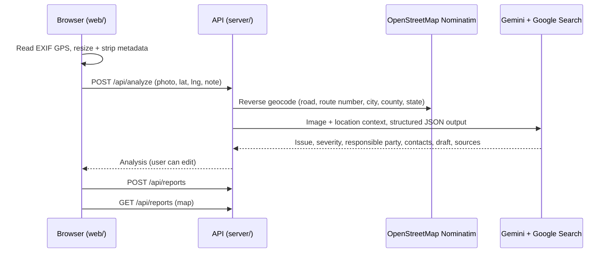

# gullhacks26-Infra

Demo web app for reporting broken public infrastructure (potholes, dead streetlights, damaged sidewalks, …).
A resident uploads a photo; the app reads the photo's GPS, and **Gemini** identifies the problem, rates severity,
works out **which organization maintains that asset at that location**, and drafts a report to send them.



The Gemini key stays on the server; the browser never sees it.

## Setup

Requires Node.js 22.18+ (runs the server's TypeScript directly).

```bash
npm install
cp server/.env.example server/.env   # then set GEMINI_API_KEY (https://aistudio.google.com/apikey)
npm run dev
```

- Web: http://localhost:5180 (Vite, proxies `/api` and `/uploads` to the API)
- API: http://localhost:8787

`GEMINI_MODEL` defaults to `gemini-3.8-flash`. The model must support image input **and** Google Search grounding
combined with structured output (Gemini 3 series or newer).

### Single-port / demo mode

```bash
npm run build
npm start            # serves the built web app + API on http://localhost:8787
```

### Testing from a phone

- Camera capture and EXIF GPS work over plain HTTP on your LAN (`http://<your-ip>:5180`).
- **"Use my location" needs HTTPS.** For a phone demo, run single-port mode and expose it with a tunnel, e.g.
  `cloudflared tunnel --url http://localhost:8787`, then open the `https://…` URL on the phone.
- Photos taken directly through the browser camera often carry no GPS; use "Use my location" or tap the map.

## API

| Method | Path                | Body / response                                                                 |
| ------ | ------------------- | ------------------------------------------------------------------------------- |
| GET    | `/api/health`       | `{ ok, geminiConfigured, model }`                                               |
| POST   | `/api/analyze`      | multipart `photo` (JPEG/PNG/WebP ≤ 10 MB), `lat`, `lng`, `note` → `AnalyzeResponse` |
| POST   | `/api/reports`      | `{ analysisId, locationSource, note, edits }` → `Report`                        |
| GET    | `/api/reports`      | `Report[]`, newest first                                                        |
| GET    | `/api/reports/:id`  | `Report`                                                                        |

Types live in [`server/src/schema.ts`](server/src/schema.ts) and are imported by the web app.
Errors are `{ "error": "message" }`.

## Layout

```
server/src/
  index.ts      Express routes, uploads, error handling
  gemini.ts     Prompt + Gemini call (image, Google Search grounding, JSON schema)
  geocode.ts    Nominatim reverse geocoding (rate-limited, cached)
  schema.ts     Zod schemas + shared API types
  store.ts      JSON-file report store (server/data/, gitignored)
web/src/
  pages/        ReportPage (upload → analyze → submit), MapPage, ReportDetailPage
  components/   LocationPicker, ResponsibleParty, Badges, Layout
  lib/          api client, photo prep (EXIF GPS, resize), Leaflet setup
```

## Demo limitations

- Reports are stored in `server/data/reports.json`; uploads in `server/data/uploads/`. Not for production.
- Pending analyses live in memory; restarting the server means re-analyzing before submitting.
- Responsible-party contacts come from Gemini's Google Search results and are shown with their sources — verify before relying on them.
- Nominatim's public server allows ~1 request/second; the API throttles and caches accordingly.

See [TODO.md](TODO.md) for the full frontend roadmap.
