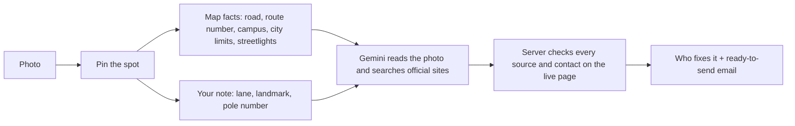

# Fix Please · fixplease.app

Spot a pothole, a dead streetlight, or something broken on campus? Take a photo, drop a pin, and Fix Please works out who is responsible for that exact spot and writes the email for you, photo attached.

Built for phones first. Works on desktop too.

## How it works



1. **Snap.** The photo is shrunk on the device and its hidden metadata is stripped. If it has GPS, we use it to suggest the spot.
2. **Pin.** Photo location, "I'm standing here", address search, or tap the map. You confirm the pin.
3. **Tell us more.** One free-text box: where exactly it is and what you noticed. This is often what separates "the city" from "the state highway department" or "the power company".
4. **Find who fixes it.** The server pulls map facts for the pin: the nearest road and its route number, whether you're inside city limits (US Census), the campus you're on and its website, and mapped streetlights and who runs them (OpenStreetMap via Overpass, with Nominatim as the fallback when Overpass is overloaded). Gemini then reads the photo and searches official city, county, state, campus, and utility sites. A typical report takes about 5–7 seconds.
5. **Send.** On phones, "Send with photo" opens the share sheet with the photo attached. On desktop, download the email with the photo already attached, or open your mail app. We never send anything for you.

### Why you can trust the result

- A link only counts if the server can open it. Pages Google's search returned count (their redirect links are resolved to the real page first). The model can also name an office's page that search didn't return, but it counts only if it's on a government or university domain, on a site search already returned, or on the campus's own website, and it loads right now. A made-up link never loads, so it's dropped.
- "Confirmed on an official site" means the sentence that proves who covers this road or asset was found word for word on that page. Otherwise the result says "Best match. Worth a quick check."
- An email address or phone number only shows up if it's published on an official page we read. If the model doesn't supply one, we look on those pages for a repair or service inbox on the office's own domain (e.g. `streetmaintenance@city.gov`). Personal, press, HR, and webmaster addresses are never picked. Many cities only take reports through a web form, so the result often links to that form and leaves the email's To line for you.
- If Gemini refuses an answer for repeating web text too closely, the server retries once without quotes. That result can be at most "best match".

## Run it locally

Requires Node.js 24.

```powershell
npm install
Copy-Item .env.example .env   # then set GEMINI_API_KEY
npm run dev
```

Open <http://127.0.0.1:5173>. The API runs on `PORT` from `.env` (default 8787) and Vite proxies `/api` to it. If something else already uses 8787, change `PORT` in `.env`.

## Try it on your phone

Location access and the bot check need HTTPS, so use a production build behind a tunnel:

```powershell
npm run build
npm start                                      # app + API on PORT
npx cloudflared tunnel --url http://127.0.0.1:8787
```

Open the `https://….trycloudflare.com` address it prints. In Safari or Chrome, "Add to Home Screen" installs it like an app. Stop the tunnel when you're done; anyone with the link can use your Gemini key while it runs.

## Deploy

Any host that runs one long-lived Node process works (Render, Railway, Fly.io, a small VM):

- Build: `npm ci && npm run build`
- Start: `npm start`
- Run a single instance. The bot check and rate limits live in memory.

| Variable | What it does |
|---|---|
| `GEMINI_API_KEY` | Required. Server-side only. Search grounding needs a billed Google AI project. |
| `GEMINI_MODEL` | Defaults to `gemini-3.5-flash-lite`. |
| `PORT`, `HOST` | Where the server listens. Use `HOST=0.0.0.0` on most hosts. |
| `TRUST_PROXY` | Set to the number of proxies in front of the app (usually `1`) so rate limits see real visitor IPs instead of the proxy's. |
| `RESEARCH_RATE_LIMIT` | Reports per visitor IP per 15 minutes (default 5). Raise it for a demo on shared Wi-Fi. |
| `GEOCODER_USER_AGENT` | Contact info sent to OpenStreetMap services. Required by their usage policy. |
| `NOMINATIM_BASE_URL` | Point at your own geocoder for real traffic. Also used for the campus lookup when Overpass fails. |
| `OVERPASS_URL` | Overpass instance for road, campus, and streetlight facts. The public one is often overloaded; the server backs off for 60 s after a failure. |
| `CAPTCHA_SECRET` | Optional stable signing secret for the bot check. |

## Privacy

- No accounts, no database, no analytics. Reports live in the page and are gone when you close it.
- The resized photo, pin, and note go to Google Gemini. Requests use `store: false`, but Google keeps search-grounded requests for up to 30 days under its API terms.
- Map tiles and address lookups come from OpenStreetMap.
- The bot check is a self-hosted proof of work (ALTCHA) that runs quietly in the browser.
- Not for emergencies. Downed wires or someone hurt: call your local emergency number.

## API

| Endpoint | Purpose |
|---|---|
| `GET /api/health` | Whether the Gemini key is configured. |
| `GET /api/captcha/challenge` | Single-use proof-of-work challenge. |
| `GET /api/locations/search?q=` | Address search. |
| `GET /api/locations/reverse?lat=&lon=` | Address for a pin. |
| `GET /api/locations/context?lat=&lon=` | Map facts for a pin (road, route number, campus, city limits, streetlights). |
| `POST /api/investigate` | `{ photoDataUrl, location, details }` plus the `X-Captcha-Token` header returns who fixes it, the evidence, and contacts. |

Errors are always `{ error, code }`. Shared types live in `shared/types.ts`.

## Checks

```powershell
npm test
npx tsc --noEmit
```
